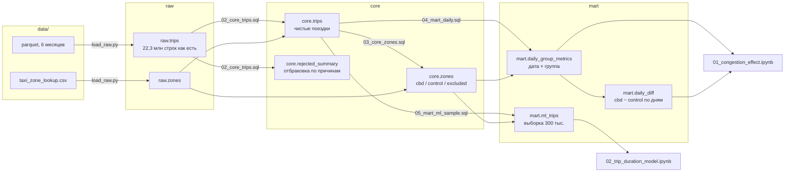

# Плата за въезд в центр Манхэттена и жёлтое такси Нью-Йорка

Как плата за въезд в южную часть Манхэттена, введённая 5 января 2025 года,
повлияла на поездки жёлтого такси. Данные: 22 млн поездок,
стек: PostgreSQL и Python (pandas, SciPy, scikit-learn).

## Вопрос и подход

С 5 января 2025 года за въезд в Congestion Relief Zone (Манхэттен южнее
60-й улицы) берётся плата. Изменились ли после этого число поездок, средняя
скорость и тариф по счётчику у поездок внутри зоны?

Районы внутри зоны — тест (`cbd`), районы Манхэттена вне зоны — контроль
(`control`). Эффект оценивается методом «разность разностей»
(difference-in-differences): насколько изменилась разность между группами
после введения платы.

## Результаты

**Эффект платы** (разность разностей «зона минус контроль», после 6 января 2025
относительно 1 октября – 19 декабря 2024):

| Метрика | Эффект | 95% бутстреп-интервал | p (Бонферрони) |
|---|---|---|---|
| Средняя скорость | +0,79 мили/ч | [0,56; 1,02] | < 0,0001 |
| Тариф по счётчику | −1,18 $ | [−1,38; −0,99] | < 0,0001 |
| log(число поездок) | 0,0089 (≈ +0,9%) | [−0,038; 0,056] | 1,0 |

Плацебо-тест с фиктивной датой 15 ноября значимых эффектов не показал.

**Модель длительности поездки.** Линейная регрессия: MAE 4,37 мин на тестовом
периоде (R² 0,541). kNN (k = 80): 4,56 мин.
Модель, обученная до введения платы, после него переоценивает длительность
поездок внутри зоны: разность изменений средних остатков зоны и контроля
−1,92 мин.

## Данные

[NYC TLC Trip Record Data](https://www.nyc.gov/site/tlc/about/tlc-trip-record-data.page),
жёлтое такси, октябрь 2024 — март 2025, формат parquet, около 360 МБ.
Плюс справочник районов `taxi_zone_lookup.csv`.

- Поездки: `https://d37ci6vzurychx.cloudfront.net/trip-data/yellow_tripdata_YYYY-MM.parquet`
- Районы: `https://d37ci6vzurychx.cloudfront.net/misc/taxi_zone_lookup.csv`

Данные в репозиторий не входят, скачиваются скриптом в `data/`.

## Схема слоёв



- **raw** — данные как есть, только нужные колонки. Каждый месяц грузится
  в одной транзакции (`DELETE` по месяцу, потом `COPY`), повторный запуск
  не создаёт дублей.
- **core** — чистка: длительность, скорость, дата и час посадки, причина
  отбраковки через `CASE`. Группы районов определяются по доле поездок
  с платой за въезд.
- **mart** — витрины для ноутбуков: дневные метрики по группам, их разности
  и выборка для модели.

```
nyc-taxi-congestion/
├── docker-compose.yml       # запасной вариант базы
├── requirements.txt
├── src/
│   ├── db.py                # подключение к базе
│   ├── download.py          # скачивает 6 месяцев и справочник
│   ├── load_raw.py          # parquet → raw, месяц = одна транзакция
│   └── build.py             # прогоняет SQL из sql/ по порядку
├── sql/
│   ├── 01_schema.sql
│   ├── 02_core_trips.sql    # чистка и таблица отбраковки
│   ├── 03_core_zones.sql    # тест/контроль по данным
│   ├── 04_mart_daily.sql
│   └── 05_mart_ml_sample.sql
└── notebooks/
    ├── 01_congestion_effect.ipynb
    └── 02_trip_duration_model.ipynb
```

## Как запустить

1. Поднять PostgreSQL: [Postgres.app](https://postgresapp.com) или
   `docker compose up -d`. Для Postgres.app создать базу:

   ```bash
   /Applications/Postgres.app/Contents/Versions/latest/bin/psql -h localhost -d postgres -c "CREATE DATABASE taxi;"
   ```

   Для Docker база создаётся сама, перед запуском скриптов нужно задать
   `export PGUSER=taxi PGPASSWORD=taxi`.

2. Установить зависимости:

   ```bash
   python3 -m venv .venv
   .venv/bin/pip install -r requirements.txt
   ```

3. Скачать данные, загрузить их в базу и собрать витрины:

   ```bash
   .venv/bin/python src/download.py
   .venv/bin/python src/load_raw.py
   .venv/bin/python src/build.py
   ```

4. Открыть ноутбуки из `notebooks/` в Jupyter (`.venv/bin/jupyter lab notebooks/`)
   или VS Code.

## Методы

### Чистка (`sql/02_core_trips.sql`)

Поездка отбраковывается по первой подходящей причине: дата посадки вне месяца
файла; длительность ≤ 0 или > 180 минут; расстояние ≤ 0 или > 100 миль;
скорость > 60 миль/ч; отрицательный тариф; служебный район посадки или
высадки. Число отбракованных по причине и месяцу хранится в
`core.rejected_summary`.

### Группы районов (`sql/03_core_zones.sql`)

Для каждого района Манхэттена берутся поездки с 6 января по 31 марта 2025,
у которых посадка и высадка в этом же районе, и считается доля поездок
с `cbd_congestion_fee > 0`. Доля ≥ 0.9 → `cbd`, ≤ 0.1 → `control`,
иначе → `excluded`. Районы с менее чем 100 такими поездками и районы вне
Манхэттена исключаются. Итог: 37 районов `cbd` южнее 60-й улицы,
16 районов `control` в Верхнем Манхэттене, 16 пограничных и малолюдных
районов исключены.

### Метрики (`sql/04_mart_daily.sql`)

По дате и группе, только поездки внутри одной группы:

- `trips` — число поездок;
- `avg_speed_mph` — суммарное расстояние, делённое на суммарное время;
- `avg_fare` — средний тариф по счётчику без доплат и платы за въезд, только
  по поездкам с `payment_type` 1–4.

Периоды: `before` — до 19 декабря 2024, `holiday` — 20 декабря — 5 января
(исключается), `after` — с 6 января 2025.

### Оценка эффекта (`notebooks/01_congestion_effect.ipynb`)

Для каждой даты разность $d_t = Y_{\text{cbd},t} - Y_{\text{control},t}$,
для числа поездок в логарифмах. Оценка эффекта:

$$\widehat{DiD} = \overline{d}_{\text{after}} - \overline{d}_{\text{before}}.$$

- **Критерий Уэлча** для средних $d_t$ до и после (`ttest_ind`, `equal_var=False`).
- **Бутстреп.** 10 000 раз дни «до» и дни «после» выбираются с возвращением,
  считается разность средних; интервал — перцентили 2.5% и 97.5%.
- **Поправка Бонферрони** на три метрики: p-value умножается на 3.
- **Плацебо.** Та же процедура на периоде `before` с фиктивной датой
  15 ноября 2024.

### Модель длительности (`notebooks/02_trip_duration_model.ipynb`)

Целевая переменная `duration_min`, признаки `trip_distance`, `pickup_hour`,
`weekday`, `pulocationid`, `dolocationid`. Категории кодируются
`OneHotEncoder(drop='first')`, расстояние масштабируется `StandardScaler`,
оба обучаются только на train. Деление по времени: обучение на октябре —
ноябре 2024, тест на 1–19 декабря 2024. Модели: бейзлайн средним,
`LinearRegression`, `KNeighborsRegressor` на подвыборке 20 тыс. с подбором k
по MAE на 5-fold кросс-валидации. Метрики на train и test: MSE, MAE в минутах
и $R^2$.

Связка с экспериментом: линейная регрессия обучается на периоде `before`
и применяется к `after`; средний остаток (факт минус прогноз) сравнивается
для поездок внутри `cbd` и внутри `control` до и после платы.

## Особенности данных

- **Отрицательные тарифы**, около 3% строк, двух видов. У строк с типами
  оплаты 1–4 в 88% случаев есть положительный двойник с тем же временем,
  районами и расстоянием: пара «поездка + сторно». Положительная половина
  остаётся в `core.trips`, отрицательная отбраковывается. Доля таких пар
  одинакова в `cbd` и `control` до и после введения платы. Второй вид —
  строки с `payment_type = 0` и тарифом около −4.75 при неправдоподобных
  расстоянии и длительности; они отбраковываются.
- **Flex Fare (`payment_type = 0`)** — поездка через приложение с ценой,
  известной заранее, не по счётчику. Доля таких поездок выросла с 9–10%
  в конце 2024 года до 18% в 2025 году одинаково в обеих группах. Они входят
  в число поездок и скорость, но не в `avg_fare`. Колонка `avg_fare_all`
  по всем поездкам оставлена для проверки.
- **Колонка `cbd_congestion_fee`** есть только в файлах 2025 года. Регистр
  имён колонок в разных файлах отличается, при загрузке они приводятся
  к нижнему регистру. Поездки с датами других месяцев отбраковываются.

## Ограничения

- **Эксперимент не рандомизированный.** DiD убирает постоянные различия между
  группами, но не изменения, которые затронули их по-разному.
- **Параллельные тренды** напрямую не проверяются, косвенная проверка —
  плацебо-тест. В первой половине декабря разность по скорости была ниже,
  а по тарифу выше, чем в октябре–ноябре, что могло повлиять на оценку.
- **Зависимость соседних дней.** Критерий Уэлча и бутстреп по дням считают
  дни независимыми, поэтому p-value и интервалы могут быть занижены.
- **Один эпизод введения платы.** Другое событие зимы 2025 года, затронувшее
  центр сильнее Верхнего Манхэттена, неотличимо от эффекта платы.
- **Только жёлтое такси.** Uber, Lyft и зелёное такси не рассматриваются.
